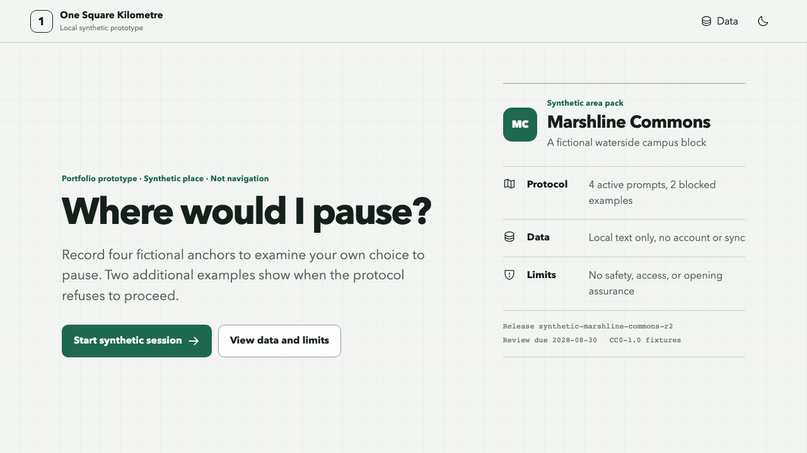
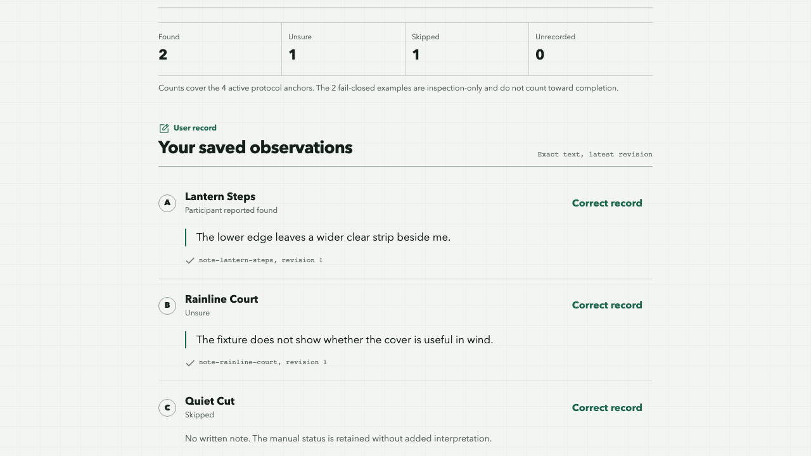

# One Square Kilometre

A local, synthetic field-protocol prototype for observing where a person might choose to pause. It is a portfolio and learning implementation, not navigation, a real NUS guide, a validated product, or a production release.

> **Independent project.** This repository is not affiliated with, endorsed by, or an official service of the National University of Singapore (NUS). All runtime places, anchors, map geometry, prompts, notes, and screenshots are synthetic.

The evidence verdict remains **Validate first**. The current PRD remains `validation-ready draft / not approved`.

Local experience acceptance candidate: **Ready for direct local review only**. This is an implementation status, not product or field approval.

## Run locally

Requirements: Node `>=22.19` and pnpm `11.19.0`. The checked local/CI baseline uses Node `22.23.1`.

```bash
pnpm install --frozen-lockfile
pnpm dev
```

Open `http://127.0.0.1:4317`.

Production-like local preview:

```bash
pnpm build
pnpm preview
```

No API key, account, server, map tile, model, GPS, camera, or network data source is needed. The deterministic core works offline after service-worker installation and one controlled online reload.

The bundled `synthetic-marshline-commons-r2` pack is an explicit demonstration release, reviewable by 2028-08-30 and expired after 2030-08-30. Runtime expiry remains fail closed. Normal automated tests pin an in-window synthetic clock and separate tests exercise expiry.

## Screenshots





## What is implemented

- A strict, fingerprint-checked, non-authoritative synthetic area manifest with four active anchors, two fail-closed examples, and release-bound provenance.
- Four usable protocol anchors plus stale and unsupported fail-closed examples outside the active route.
- A project-authored SVG and DOM map with a complete equivalent anchor list. No Canvas or WebGL is used.
- One observation theme, manual `found / unsure / skipped` check-in, optional local text note, dedicated correction mode, stopped-record correction, and undo.
- A deterministic recap that separates exact user records, synthetic fixture metadata, and unavailable inference.
- Local draft persistence, storage preflight, strict manifest-bound restore, recovery export, opaque-token multi-tab conflict detection, export, and verified hard delete.
- Loading, empty, pack error, storage error, stale, unsupported, offline, list-only, stopped, export, and deletion states.
- Light and dark themes, keyboard focus, reduced motion, 320px layout support, and React Aria interaction primitives.

## Verification

```bash
pnpm lint
pnpm typecheck
pnpm test
pnpm build
pnpm bundle:check
pnpm test:e2e
pnpm test:a11y
pnpm test:offline
```

The full local gate is:

```bash
pnpm verify
```

The non-technical acceptance order, expected outcomes, reset method, cannot-claim list, and fixed-size desktop/mobile screenshot index are in [implementation/EXPERIENCE_ACCEPTANCE.md](implementation/EXPERIENCE_ACCEPTANCE.md).

Chromium is the only automated browser target in this prototype. Install its matching local test runtime when needed:

```bash
pnpm exec playwright install chromium
```

## Local failure views

Development-only review scenarios can be combined in `?demo=`. A default production build ignores these parameters:

- `list-only`
- `offline`
- `offline-first`
- `pack-error`
- `fixture-parse-error`
- `provenance-parse-error`
- `empty`
- `stale-pack`
- `storage-preflight-error`
- `storage-error`
- `delete-error`

Example: `http://127.0.0.1:4317/?demo=list-only,offline`.

These are deterministic review fixtures. They are not evidence that a real environment, route, device, or user need has been validated.

## Review artifacts

- [Actual architecture](implementation/ARCHITECTURE.md)
- [Privacy and data boundary](implementation/PRIVACY.md)
- [Known limitations and cannot-claim list](implementation/KNOWN_LIMITATIONS.md)
- [Fixtures and licences](implementation/FIXTURES_AND_LICENSES.md)
- [Test evidence](implementation/TEST_EVIDENCE.md)
- [Experience acceptance guide](implementation/EXPERIENCE_ACCEPTANCE.md)
- [Public review summary](docs/REVIEW_SUMMARY.md)
- [Council disposition](implementation/council/council-disposition.md)
- [Experience acceptance council](implementation/council/experience-acceptance-council.md)
- [Independent code and security review](implementation/council/independent-code-security-review.md)
- [Desktop overview](artifacts/screenshots/desktop-experience-01-overview.png)
- [Mobile overview](artifacts/screenshots/mobile-experience-01-overview.png)
- [Desktop recap evidence](artifacts/screenshots/desktop-experience-05b-recap-evidence.png)
- [Mobile data rights](artifacts/screenshots/mobile-experience-06b-data-rights.png)

The ten staged product and technical documents are in [`docs/00_SOURCE_OF_TRUTH.md`](docs/00_SOURCE_OF_TRUTH.md) through [`docs/09_EXECUTION_PLAN.md`](docs/09_EXECUTION_PLAN.md). Raw council working memos, generated builds, coverage, browser reports, traces, caches, and unselected screenshots are intentionally not part of the public baseline.

## Contributing, security, and support

- [Contributing](CONTRIBUTING.md)
- [Code of Conduct](CODE_OF_CONDUCT.md)
- [Security policy](SECURITY.md)
- [Support boundary](SUPPORT.md)
- [Changelog](CHANGELOG.md)

Contributions must use synthetic data and rights-cleared assets. Do not submit real locations, private data, NUS-owned material, credentials, or generated test artifacts.

## Licence

- Code, tests, scripts, configuration, documentation, and selected screenshots: [MIT](LICENSE).
- `src/fixtures/area-manifest.json` and `src/fixtures/provenance-manifest.json`: [CC0-1.0](LICENSES/CC0-1.0.txt).
- Third-party packages remain under their own licences; see [THIRD_PARTY_NOTICES.md](THIRD_PARTY_NOTICES.md) and [LICENSES/README.md](LICENSES/README.md).

The licences permit reuse under their terms. This project does not validate or support hosted-product deployment, real field packs, participant recruitment, real private data, or claims of approved product/field capability.
